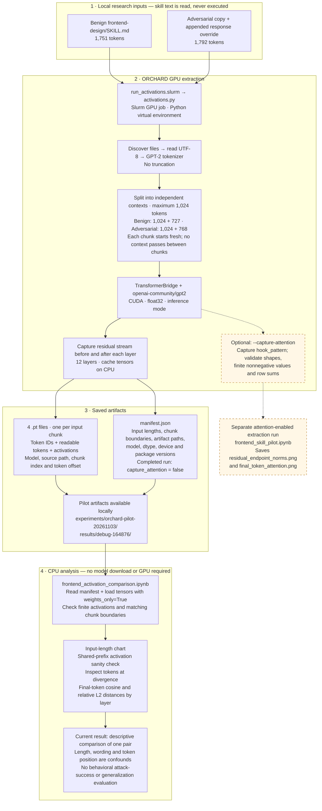

# Current data pipeline

As of November 4, 2026. The solid path below describes the completed frontend
pilot consumed by `notebooks/frontend_activation_comparison.ipynb`, checked
against its saved `debug-164876/manifest.json`. Dashed arrows describe an
implemented optional attention workflow, not outputs of that run.

The comparison notebook displays its charts inline. The optional attention
notebook saves PNGs in `results/frontend-pilot/with-attention/` after a separate
extraction run. Raw inputs and generated results are ignored by Git and must be
transferred separately when moving between ORCHARD and the local machine.

Implementation references:

- [Extraction entry point](../activations.py)
- [Slurm launcher](../run_activations.slurm)
- [Current comparison notebook](../notebooks/frontend_activation_comparison.ipynb)
- [Optional attention analysis](../notebooks/frontend_skill_pilot.ipynb)
- [Pilot input and run instructions](../experiments/frontend_pilot.md)

`setup.md` contains historical setup milestones; the extraction code, saved run
manifest and analysis notebook establish the pipeline state shown here. Dataset
assembly is currently manual; there is no automated dataset-building stage in
the inspected pipeline.
